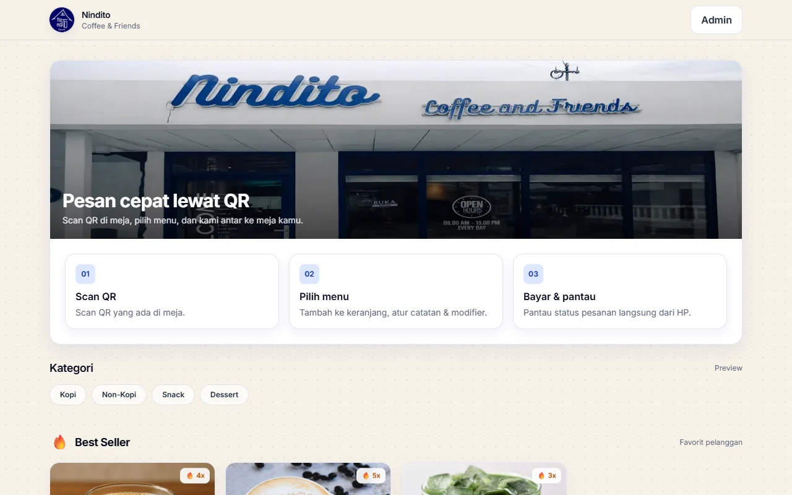

# Nindito Coffee & Friends — QR Ordering System

> [!TIP]
> **Live Storefront:** [`https://cafeqrv2.gimmhost.my.id/`](https://cafeqrv2.gimmhost.my.id/)

Smart table-QR ordering & kitchen display workflow untuk kafe modern: pelanggan scan QR di meja, pilih menu dengan modifier, bayar, dan pantau pesanan *real-time* sementara dapur memproses antrean.



### Alur Pemesanan Meja (`QR → Kitchen → Done`)

```text
[Scan QR /t/{token}] ──► [Menu & Modifier Cart] ──► [Checkout / iPaymu] ──► [Live Order Status] ──► [Dapur / Admin]
```

### Stack & Menjalankan Lokal

- **Stack:** Laravel 12 · Vue.js · Pinia · Tailwind CSS · MySQL · Endroid QR Code · iPaymu

```bash
composer install && npm install
cp .env.example .env && php artisan key:generate
php artisan migrate --seed
npm run dev & php artisan serve
```
